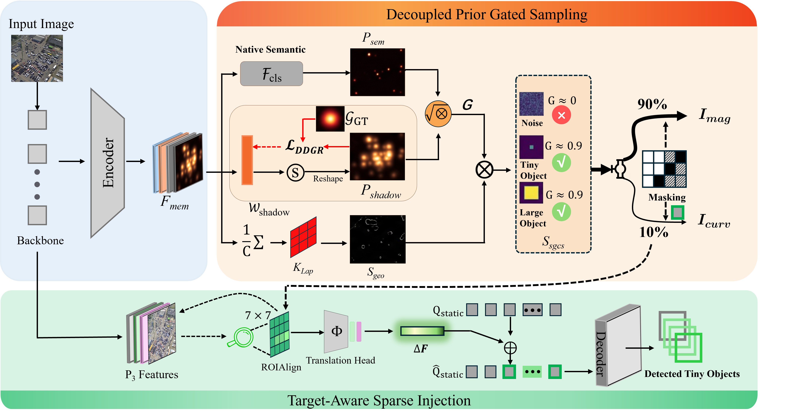

# Revive-DETR: Combatting Representation Collapse for Tiny Object Detection

[](#)
[](LICENSE)

> **[Revive-DETR: Combatting Representation Collapse for Tiny Object Detection](#)** <br>
> Xin Feng, Ang Gao, Liu Cui, Yunlong Wang <br>
> *British Machine Vision Conference (BMVC), 2026* | [Paper Coming Soon]

---



## 📖 Introduction

Despite the rapid progress of generic object detectors, Tiny Object Detection (TOD) remains a challenging problem. We identify **Representation Collapse** as a key bottleneck: as feature maps are repeatedly down-sampled in deep networks, the sparse structural cues of tiny objects are progressively weakened and overwhelmed by background clutter, leading to unreliable query initialization and weak discriminative representations.

To address this issue, we propose **Revive-DETR**, a plug-and-play framework that improves tiny object detection through **query isolation** and **feature revival**. 

* This repository is the official PyTorch implementation of the paper *Revive-DETR: Combatting Representation Collapse for Tiny Object Detection*.
* Our codebase is built upon the excellent [DQ-DETR](https://github.com/hoiliu-0801/DQ-DETR) repository. We sincerely thank the authors for their great open-source work.

## 📢 News
- **[2026/8]**: **Revive-DETR** has been accepted by **BMVC 2026**. 🔥🔥🔥

## ✨ Highlights

- 🎯 **Decoupled Prior Gated Sampling (DPGS):** Combines spatial priors with local geometric cues to allocate a dedicated query quota for tiny objects, effectively reducing their competition with larger objects and background noise during query initialization.
- 💉 **Target-Aware Sparse Injection (TASI):** Guided by the localized queries, TASI extracts high-resolution patches from shallow feature maps, translates them into semantic-aware residuals, and injects them back into deep query embeddings.
- 🪶 **Extremely Lightweight & Plug-and-Play:** With a zero-initialized injection design, our modules can be seamlessly integrated into various DETR-based detectors, achieving SOTA performance with an extremely low computational overhead (~0.5% FLOPs increase).

## 📊 Performance

### 1. Experimental Results on AI-TOD
As a plug-and-play component, Revive-DETR consistently improves the performance of multiple state-of-the-art DETR architectures, especially on the highly challenging $AP_{vt}$ (very tiny objects) metric.

| Method | AP | AP<sub>50</sub> | AP<sub>75</sub> | AP<sub>vt</sub> | AP<sub>t</sub> | AP<sub>s</sub> |
|:---|:---:|:---:|:---:|:---:|:---:|:---:|
| DINO-R50 | 17.5 | 43.4 | 10.1 | 6.0 | 20.4 | 20.8 |
| <b>+ Ours</b> | <b>17.9</b> (+0.4) | <b>43.7</b> (+0.3) | <b>10.8</b> (+0.7) | <b>7.9</b> (+1.9) | <b>21.2</b> (+0.8) | <b>22.5</b> (+1.7) |
| DINO-SwinT | 12.8 | 36.0 | 6.0 | 11.2 | 14.2 | 16.8 |
| <b>+ Ours</b> | <b>13.9</b> (+1.1) | <b>36.7</b> (+0.7) | <b>6.5</b> (+0.5) | <b>13.8</b> (+2.6) | <b>16.1</b> (+1.9) | <b>19.2</b> (+2.4) |
| DQ-DETR | 23.8 | 54.5 | 16.7 | 16.0 | 26.0 | 28.9 |
| <b>+ Ours</b> | <b>25.1</b> (+1.3) | <b>58.4</b> (+3.9) | <b>17.1</b> (+0.4) | <b>19.2</b> (+3.2) | <b>27.6</b> (+1.6) | <b>31.8</b> (+2.9) |
| RT-DETR | 16.6 | 41.4 | 8.2 | 5.7 | 18.9 | 19.2 |
| <b>+ Ours</b> | <b>17.4</b> (+0.8) | <b>41.8</b> (+0.4) | <b>8.9</b> (+0.7) | <b>7.1</b> (+1.4) | <b>20.1</b> (+1.2) | <b>20.8</b> (+1.6) |
| Dome-DETR | 23.2 | 51.1 | 17.3 | 10.0 | 25.8 | 30.2 |
| <b>+ Ours</b> | <b>25.1</b> (+1.9) | <b>53.3</b> (+2.2) | <b>19.1</b> (+1.8) | <b>12.9</b> (+2.9) | <b>28.1</b> (+2.3) | <b>32.8</b> (+2.6) |

### 2. Experimental Results on VisDrone2019
The robust generalization ability of our method across diverse aerial scenarios and scale distributions.

| Method | AP | AP<sub>50</sub> | AP<sub>75</sub> | AP<sub>vt</sub> | AP<sub>t</sub> | AP<sub>s</sub> |
|:---|:---:|:---:|:---:|:---:|:---:|:---:|
| DINO-R50 | 32.2 | 55.3 | 33.0 | 10.8 | 20.5 | 29.7 |
| <b>+ Ours</b> | <b>32.9</b> (+0.7) | <b>55.7</b> (+0.4) | <b>33.0</b> | <b>12.1</b> (+1.3) | <b>20.5</b> | <b>30.2</b> (+0.5) |
| DQ-DETR | 36.0 | 59.1 | 36.7 | 10.3 | 21.1 | 33.5 |
| <b>+ Ours</b> | <b>36.3</b> (+0.3) | <b>59.4</b> (+0.3) | <b>37.3</b> (+0.6) | <b>11.2</b> (+0.9) | <b>21.5</b> (+0.4) | <b>34.0</b> (+0.5) |
| RT-DETR | 27.6 | 46.4 | 27.1 | 8.1 | 16.6 | 25.6 |
| <b>+ Ours</b> | <b>28.3</b> (+0.7) | <b>46.9</b> (+0.5) | <b>27.5</b> (+0.4) | <b>9.2</b> (+1.1) | <b>17.1</b> (+0.5) | <b>26.0</b> (+0.4) |

### 3. Model Complexity and Inference Efficiency
Analysis on the DQ-DETR baseline indicates that DPGS and TASI introduce an extremely small computational overhead (only an increase of ~0.5% in GFLOPs), validating the practical efficiency of our framework.

| Method | Params | GFLOPS | Inference Time | FPS |
|:---|:---:|:---:|:---:|:---:|
| DQ-DETR | 57.45M | 901.76 | 212.48ms | 4.71 |
| DQ-DETR + DPGS | 57.45M | 901.78 | 214.55ms | 4.66 |
| DQ-DETR + TASI | 61.32M | 902.73 | 217.41ms | 4.60 |
| **DQ-DETR + DPGS + TASI (Ours)** | **61.32M** | **906.39** | **219.49ms** | **4.56** |


## 🛠️ Installation

Our environment configuration follows the official [DINO DETR](https://github.com/IDEA-Research/DINO) repository.

1. **Create and activate the conda environment:**
```sh
conda create -n revivedetr python=3.9 -y
conda activate revivedetr

2. **Compile CUDA operators:**
```bash
bash install.sh
```

## 🚀 Usage

### Training

Update the pretrained model path and dataset path in `scripts/Revive.sh`, then run:
```bash
CUDA_VISIBLE_DEVICES=0,1,2 bash scripts/Revive.sh /path/to/your/dataset
```

### Evaluation

Evaluate a trained model using the evaluation script:
```bash
bash scripts/Revive_eval.sh /path/to/your/dataset /path/to/your/checkpoint.pth
```

## 📦 Datasets

We use **AI-TOD-v1** datasets for our main experiments.

* **Step 1:** Download the datasets from the [official DQ-DETR Google Drive link](https://drive.google.com/drive/folders/1CowS5BrujefWQxxlmOFfUuLOfUUm8w6U?usp=sharing).
* **Step 2:** Organize the downloaded files in the following directory structure:

```text
├─ Dataset
│   └─ aitod
│       ├─ annotations
│       ├─ images
│       ├─ test
│       ├─ train
│       ├─ trainval
│       └─ val
├─ Revive-DETR
```

## 📝 Citation

If you find this work or code useful for your research, please consider citing our paper:

```bibtex
@InProceedings{feng2026revivedetr,
    author    = {Feng, Xin and Gao, Ang and Cui, Liu and Wang, Yunlong},
    title     = {Revive-DETR: Combatting Representation Collapse for Tiny Object Detection},
    booktitle = {British Machine Vision Conference (BMVC)},
    year      = {2026}
}
```

## 🙏 Acknowledgement

This official implementation is heavily built upon the excellent [DQ-DETR](https://github.com/hoiliu-0801/DQ-DETR) and [DINO](https://github.com/IDEA-Research/DINO) codebases. We sincerely thank the authors for their great open-source contributions to the community.